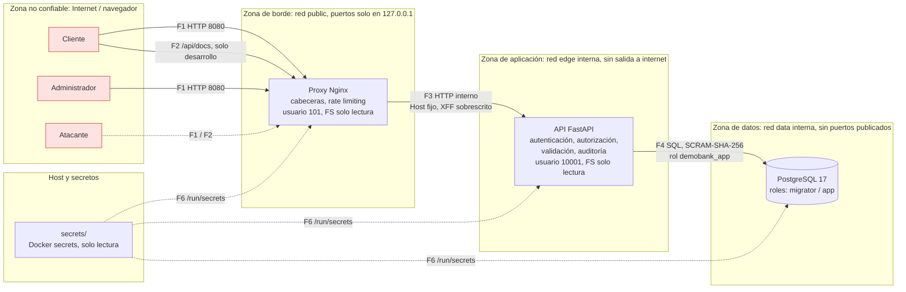

# Arquitectura de Secure DemoBank

> Responsable: Arquitectura y DevSecOps · Entregable 1 (semanas 1 y 2) · Última revisión: 2026-10-31
>
> Relacionado: [Modelo de amenazas STRIDE](modelo-amenazas.md) · [Pipeline DevSecOps](devsecops.md)

## 1. Propósito y supuestos

Secure DemoBank es una **billetera digital simulada**: los usuarios se registran, consultan su saldo, transfieren
dinero ficticio a otros usuarios del sistema y revisan su historial. Un administrador gestiona usuarios y consulta la
bitácora de auditoría. No se conecta con bancos ni pasarelas reales.

Este documento describe **cómo está construido el sistema y por qué**, desde el punto de vista de la seguridad.

**Supuestos de alcance** (a validar contra el documento de requisitos y la matriz de roles):

| Supuesto | Impacto en la arquitectura |
|---|---|
| Roles: `cliente` y `administrador` | Autorización por rol en el backend (amenaza T-20) |
| Operaciones de dinero: consultar saldo, transferir, historial | Integridad transaccional en PostgreSQL (T-07, T-08) |
| Frontend y API se sirven desde el **mismo origen** | Sin CORS; cookies `SameSite=Strict` (T-09) |
| Entorno: local con Docker; sin despliegue público | Solo accesible desde la propia máquina (`127.0.0.1`) |
| Stack: FastAPI + PostgreSQL; frontend de libre elección (preferentemente React) | La arquitectura no depende de la opción de frontend |

## 2. Vista general

Las líneas punteadas que cruzan una zona son **límites de confianza** (sección 4). Cada flujo `F*` está detallado en
la sección 5 y analizado con STRIDE en el modelo de amenazas.

## 3. Componentes y responsabilidades

| Componente | Tecnología | Responsabilidad de seguridad | Lo que NO hace |
|---|---|---|---|
| **Proxy** | `nginxinc/nginx-unprivileged:1.30-alpine` | Rechazar Host desconocidos; cabeceras de seguridad y CSP; rate limiting; límites de tamaño y tiempo; servir el frontend estático | No toma decisiones de autenticación ni autorización |
| **API** | FastAPI sobre Uvicorn, Python 3.12 | Autenticación, autorización por rol y por recurso, validación de entradas, reglas de negocio de dinero, manejo de errores, bitácora de auditoría | No confía en nada del cliente, aunque llegue por el proxy |
| **Base de datos** | PostgreSQL 17 | Persistencia; integridad (transacciones, `CHECK`, llaves foráneas); mínimo privilegio por rol | No es alcanzable desde fuera de la red `data` |
| **Frontend** | Libre elección (preferentemente React) | Interfaz; no guardar secretos en el navegador; respetar la CSP (sin código inline) | No contiene lógica de autorización (solo la refleja) |
| **Secretos** | Archivos en `secrets/`, montados como Docker secrets | Contraseñas de BD y llave de firma de la app | Nunca se versionan ni viajan como variables de entorno |
| **CI** | GitHub Actions | Gitleaks, Semgrep, pip-audit, revisión de dependencias, pruebas | Ver [devsecops.md](devsecops.md) |

### Roles de base de datos

| Rol | Uso | Privilegios |
|---|---|---|
| `postgres` | Solo el arranque inicial del contenedor | Superusuario. **La aplicación nunca lo usa.** |
| `demobank_migrator` | Migraciones (crear y alterar tablas) | Dueño del esquema `app`. Sin `SUPERUSER`, `CREATEDB` ni `CREATEROLE`. |
| `demobank_app` | La API en tiempo de ejecución | `SELECT/INSERT/UPDATE/DELETE` sobre las tablas del migrator. **Sin DDL**, máximo 20 conexiones. |

Si la API sufre una inyección SQL, el atacante queda limitado a DML: no puede crear, alterar ni borrar tablas,
ni crear roles. Las tablas *append-only* (bitácora de auditoría) deben además revocar `UPDATE` y `DELETE` a
`demobank_app` en su migración (T-11).

## 4. Límites de confianza

| ID | Límite | Qué lo cruza | Por qué es un límite | Controles en el límite |
|---|---|---|---|---|
| **TB-1** | Navegador ↔ Proxy | Toda petición externa (F1, F2) | Aquí entra cualquier dato controlado por el atacante: cuerpo, cabeceras, Host, cookies | Puerto publicado solo en `127.0.0.1`, servidor por defecto que responde 421 a Host ajenos, límite de cuerpo (64 KB) y tiempos, rate limiting, cabeceras y CSP |
| **TB-2** | Proxy ↔ API | Peticiones ya filtradas (F3) | El proxy filtra *forma*, no *intención*: la API sigue tratando el contenido como no confiable | Red interna `edge`; Host fijo; `X-Forwarded-For` sobrescrito por el proxy; Uvicorn solo acepta cabeceras de proxy desde la subred `edge` |
| **TB-3** | API ↔ Base de datos | Consultas SQL (F4) | La BD guarda los activos más valiosos; una API comprometida no debe poder hacer cualquier cosa | Red interna `data`; usuario sin DDL; consultas parametrizadas (ORM); autenticación SCRAM-SHA-256 |
| **TB-4** | Host ↔ Contenedores | Secretos (F6), kernel compartido | Un contenedor comprometido no debe escalar al host ni leer secretos de otros servicios | Cada servicio monta solo sus secretos; sin root; `cap_drop: ALL`; `no-new-privileges`; FS solo lectura; límites de memoria y procesos |
| **TB-5** | Desarrollo ↔ Repositorio/CI | Código, dependencias, actions (F7) | El código y sus dependencias pueden introducir vulnerabilidades o secretos | Gitleaks (pre-commit y CI), Semgrep, pip-audit, revisión de dependencias en PRs, actions fijadas por SHA |

## 5. Flujos de datos

| Flujo | Origen → destino | Datos | Protocolo | Protección |
|---|---|---|---|---|
| **F1** | Navegador → Proxy | Credenciales, cookie o token de sesión, montos, datos personales | HTTP en `127.0.0.1:8080` (el tráfico no sale de la máquina) | Puerto publicado solo en loopback; cabeceras de seguridad en la respuesta |
| **F2** | Navegador → Proxy → API | Documentación interactiva y esquema OpenAPI | HTTP en `127.0.0.1:8080` | Solo existe con `APP_ENV=development`; CSP propia en `/api/docs` |
| **F3** | Proxy → API | Las mismas peticiones de F1 | HTTP en red interna `edge` | Red sin salida y sin otros participantes; cabeceras saneadas por el proxy |
| **F4** | API → PostgreSQL | Consultas y resultados (saldos, movimientos, hashes) | Protocolo PostgreSQL en red interna `data` | Rol `demobank_app`, SCRAM-SHA-256, consultas parametrizadas |
| **F5** | Migraciones → PostgreSQL | DDL | Protocolo PostgreSQL | Rol `demobank_migrator`, que no usa la API (pendiente: servicio `migrate` de un solo uso) |
| **F6** | Host → contenedores | Contraseñas y llave de firma | Montaje de archivo de solo lectura en `/run/secrets` | Generados con CSPRNG (256 bits); `secrets/` en `.gitignore`; cada servicio recibe solo los suyos |
| **F7** | Desarrollador → GitHub → Actions | Código fuente y dependencias | HTTPS/SSH a GitHub | Pipeline de seguridad en cada push y PR |
| **F8** | Servicios → logs | Eventos, errores, auditoría | stdout de Docker | Sin secretos ni datos sensibles en logs (`SecretStr`, `hide_parameters`) |

> **Tráfico sin cifrar (F1, F3 y F4):** nunca sale de la máquina: el puerto del proxy solo escucha en `127.0.0.1` y
> las redes internas no tienen salida ni otros participantes. Queda registrado en el modelo de amenazas como
> riesgo aceptado (RA-01).

## 6. Puntos de entrada

| Punto de entrada | Expuesto a | Notas |
|---|---|---|
| `http://localhost:8080/` | Navegador | Frontend estático |
| `http://localhost:8080/api/*` | Navegador | API; 20 req/s por IP (ráfaga de 40) |
| `http://localhost:8080/api/auth/*` | Navegador | Login y registro; 10 req/min por IP (ráfaga de 5) |
| `http://localhost:8080/api/docs` y `/api/openapi.json` | Navegador | **Solo con `APP_ENV=development`**; ZAP los usa para escanear la API |
| Puerto 5432 de la BD | **Nadie fuera de la red `data`** | No se publica en el host |
| Repositorio y PRs | Integrantes del equipo | Protegidos por el pipeline de CI |

## 7. Activos que requieren protección

| ID | Activo | C | I | D | Dónde vive |
|---|---|---|---|---|---|
| A-01 | Credenciales de usuarios (hash de contraseñas, semillas MFA) | Alta | Alta | Media | BD |
| A-02 | Sesiones y tokens | Alta | Alta | Media | Navegador, API |
| A-03 | Saldos y cuentas | Media | **Crítica** | Alta | BD |
| A-04 | Historial de transacciones | Alta | Alta | Media | BD |
| A-05 | Datos personales (nombre, correo) | Alta | Media | Media | BD |
| A-06 | Bitácora de auditoría | Media | **Crítica** | Media | BD |
| A-07 | Secretos de infraestructura (contraseñas de BD, llave de firma) | **Crítica** | Alta | Alta | `secrets/`, `/run/secrets` |
| A-08 | Código fuente, dependencias y pipeline | Baja | Alta | Media | GitHub |

C = confidencialidad, I = integridad, D = disponibilidad.

## 8. Decisiones de diseño seguro

| ID | Decisión | Principio | Justificación | Amenazas |
|---|---|---|---|---|
| D-01 | Proxy inverso como **único** punto de entrada; API y BD sin puertos publicados | Reducir la superficie de ataque | Un solo lugar donde aplicar cabeceras y límites; lo que no se expone no se puede atacar directamente | T-16, T-18 |
| D-02 | Límites de tamaño y de tiempo en el borde (cuerpo de 64 KB, 10 s) | Disponibilidad | Una API de JSON pequeño no necesita cuerpos grandes ni conexiones lentas; se cortan antes de consumir recursos de la API | T-18 |
| D-03 | Tres redes; `edge` y `data` internas, sin salida a internet | Mínimo privilegio (red) | Si la API se compromete, no puede exfiltrar datos ni descargar herramientas; el proxy ni siquiera resuelve el nombre `db` | T-16, T-21 |
| D-04 | Puertos publicados solo en `127.0.0.1` | Reducir la superficie de ataque | El entorno de desarrollo no queda expuesto a la red WiFi o del laboratorio | T-18 |
| D-05 | Secretos como Docker secrets en archivos, generados con CSPRNG; nunca en el repo ni en variables de entorno | Protección de secretos | Las variables de entorno se filtran en `docker inspect`, volcados de error y procesos hijos; los archivos montados no | T-15 |
| D-06 | Contenedores sin root, FS solo lectura, `cap_drop: ALL`, `no-new-privileges`, límites de memoria y procesos | Mínimo privilegio y contención | Un RCE no puede instalar nada, escribir en disco ni escalar privilegios dentro del contenedor | T-21 |
| D-07 | Roles de BD separados (`migrator` para DDL, `app` solo DML) | Mínimo privilegio y separación de funciones | Limita el daño de una inyección SQL y permite una bitácora *append-only* | T-06, T-11, T-16 |
| D-08 | `APP_ENV` es `production` por defecto: sin `/api/docs` salvo que se pida explícitamente | Seguro por defecto | Olvidar una variable no debe exponer la documentación interactiva | T-14 |
| D-09 | Cabeceras de seguridad y CSP estricta (sin `unsafe-inline`) centralizadas en el proxy | Defensa en profundidad | Mitigan XSS y clickjacking aunque el frontend cometa un error | T-10, T-23 |
| D-10 | Rate limiting en el borde, más estricto en `/api/auth/` | Disponibilidad y anti-automatización | Frena fuerza bruta y abuso antes de consumir recursos de la API | T-03, T-18 |
| D-11 | El proxy fija `Host` y sobrescribe `X-Forwarded-For`; Uvicorn solo confía en la subred del proxy | No confiar en la entrada del cliente | Evita Host header injection, DNS rebinding y falsificar la IP registrada en auditoría | T-05, T-12 |
| D-12 | Frontend y API en el mismo origen | Simplicidad | Sin CORS que configurar mal; permite cookies `SameSite=Strict` | T-09 |
| D-13 | Dependencias, imágenes y actions fijadas por versión o SHA; escaneo continuo | Seguridad de la cadena de suministro | Builds reproducibles; ningún cambio de versión entra sin pasar por CI | T-22 |
| D-14 | Errores genéricos al cliente y detalle solo en logs del servidor | Fallar de forma segura | El cliente nunca ve trazas, consultas ni rutas internas | T-14 |
| D-15 | FastAPI + PostgreSQL | Usar controles maduros | Pydantic valida tipos y rangos por defecto; PostgreSQL ofrece transacciones ACID, `CHECK`, bloqueos de fila y roles | T-06, T-07, T-08 |

## 9. Verificación de los controles de infraestructura

Pruebas manuales realizadas el 2026-10-31 sobre el stack levantado con `python scripts/dev.py up`. Las pruebas
automatizadas (ZAP, casos de prueba de seguridad) se suman en las semanas 4 y 5.

| Control | Prueba | Esperado | Obtenido |
|---|---|---|---|
| Puerto solo en loopback | `docker compose ps` | Proxy publicado en `127.0.0.1:8080`; sin puertos en `backend` ni `db` | Proxy en `127.0.0.1:8080`; `backend` y `db` sin puertos publicados; el puerto 8080 solo escucha en `127.0.0.1` |
| Host ajeno rechazado | `curl -H "Host: evil.example" http://localhost:8080/api/health` | `421` | `421` |
| Cabeceras de seguridad | `curl -D - http://localhost:8080/` | CSP, `nosniff`, `DENY`, `no-referrer`, COOP, CORP, Permissions-Policy | Todas presentes |
| API sin caché | `curl -D - http://localhost:8080/api/health` | `Cache-Control: no-store` y CSP `default-src 'none'` | |
| Límite de cuerpo | `POST` de 70 KB a `/api/health` | `413` | `413` |
| Rate limiting en auth | 9 peticiones seguidas a `/api/auth/login` | `429` a partir de la 7ª (1 + ráfaga de 5) | 6 × `404`, luego 3 × `429` |
| BD no publicada | `docker compose ps` | Sin puerto publicado en `db` | (el 5432 del host es un PostgreSQL nativo de Windows, ajeno al proyecto) |
| Mínimo privilegio en BD | `CREATE TABLE` y `DROP TABLE` como `demobank_app` | Rechazados | `permission denied for schema app` / `must be owner of table` |
| DML de la API | `INSERT` y `SELECT` como `demobank_app` sobre una tabla del migrator | Permitido | |
| Contenedores sin root | `id -u` en cada servicio | Distinto de 0 | proxy 101, backend 10001, db 70 |
| FS solo lectura | `touch /probe` en cada servicio | Error | `Read-only file system` en los tres |
| API sin salida a internet | `urlopen('https://pypi.org')` desde el backend | Falla | `Temporary failure in name resolution` |
| Proxy aislado de la BD | `nc -z db 5432` desde el proxy | Falla | `bad address 'db'` |
| Secretos fuera del entorno | `env \| grep -ci password` en el backend | `0` | `0` |

## 10. Lineamientos para el resto del equipo

**Backend y seguridad de acceso**

- Los secretos se leen con `get_settings()` (`backend/app/config.py`). Si necesitas uno nuevo: agrégalo en
  `PASSWORD_SECRETS`/`KEY_SECRETS` de `scripts/dev.py`, en `secrets:` de `docker-compose.yml` y como `SecretStr`
  en `Settings`.
- Las migraciones (Alembic) corren con `demobank_migrator`, nunca con el usuario de la API. Propuesta: un servicio
  `migrate` de un solo uso en Compose del que dependa `backend`.
- Dinero en **enteros (centavos)** o `Decimal`, nunca `float`. `CHECK (saldo >= 0)` en la tabla.
- Transferencias en **una transacción** con `SELECT ... FOR UPDATE` sobre ambas cuentas (en orden fijo para evitar
  *deadlocks*) y una llave de idempotencia (T-08).
- Esquemas Pydantic con `extra="forbid"` para evitar *mass assignment* de campos como `rol` o `saldo` (T-07).
- Toda consulta de un recurso filtra por el dueño autenticado, no solo por ID (IDOR, T-13).

**Frontend y pruebas**

- La CSP no permite JS ni CSS inline. Si el framework elegido lo requiere, documentar el ajuste en `proxy/default.conf`.
- Mismo origen: no configurar CORS. Si se usan cookies de sesión, `HttpOnly; SameSite=Strict` más un token CSRF.
- ZAP se apunta a `http://localhost:8080` y puede importar `http://localhost:8080/api/openapi.json` (con `APP_ENV=development`).

**Documentación y gestión**

- Los IDs `T-xx` (amenazas), `D-xx` (decisiones) y `A-xx` (activos) son estables: úsalos en el registro de
  vulnerabilidades para la trazabilidad amenaza → riesgo → mitigación → implementación → prueba → resultado.
